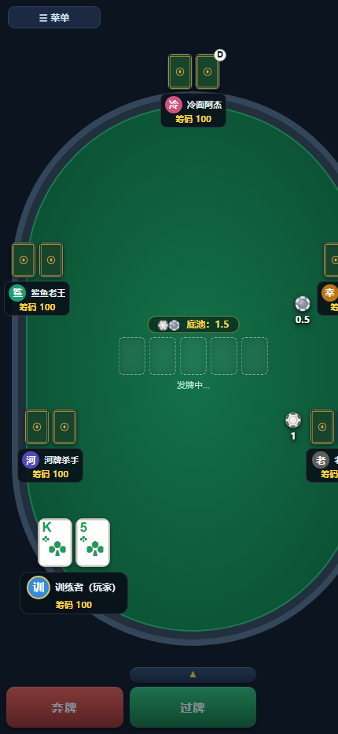
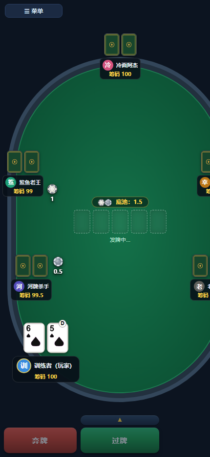
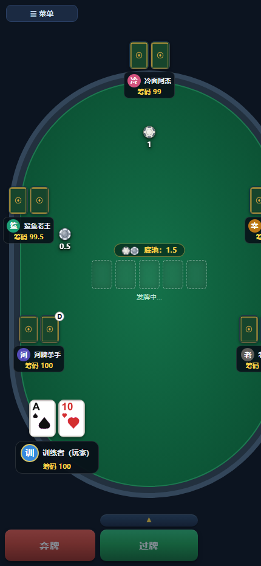
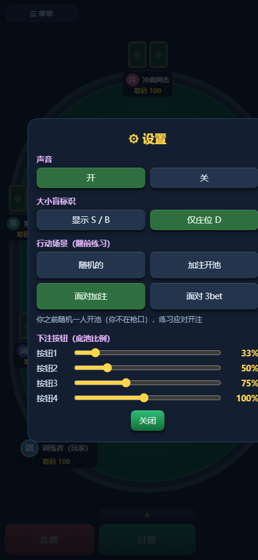

# GTO 策略培养皿

一款面向移动端与桌面浏览器的德州扑克策略训练和多人对局应用。项目以零依赖的 Node.js 服务端承载页面、音效、卡牌素材和联机消息，既可单人练习，也可通过局域网或临时公网隧道与朋友对局。



## 功能

- **GTO 策略训练**：按位置与行动线查询翻前范围，并结合牌面、范围和筹码深度给出翻后策略。
- **翻后求解**：内置翻后查表、现场求解内核和浏览器侧求解桥接。
- **多人联机**：支持房主权威模式、房间码加入、座位管理、断线重连和牌面信息按玩家脱敏。
- **完整对局体验**：覆盖下注、加注、全下、摊牌、战绩记录、音效和移动端适配。
- **两种组局方式**：常规多人桌与双人超能力单挑。
- **一键公网联机**：通过 Cloudflare Quick Tunnel 生成临时公网地址和加入二维码。

## 快速开始

需要 [Node.js](https://nodejs.org/) 18 或更高版本。应用没有 npm 第三方依赖。

```powershell
npm start
```

启动后打开：

```text
http://localhost:8787/
```

同一局域网内的手机可以通过启动页显示的本机地址访问。也可以直接运行：

```powershell
node server.js
```

如需修改端口：

```powershell
$env:PORT = "8080"
npm start
```

## 公网联机

Windows 用户可以双击 `启动公网联机.bat`。脚本会启动本地服务并创建 Cloudflare 临时隧道，同时生成可用于加入房间的地址和二维码。

首次使用需将 `cloudflared.exe` 放到 `tools/` 目录。该二进制文件体积较大，且不同平台版本不同，因此不纳入 Git 仓库。

也可以直接运行：

```powershell
npm run start:public
```

## 测试

```powershell
npm test
```

仓库同时包含联机、移动端界面、稳定性、求解器和规则一致性等专项测试，例如：

```powershell
node test-mp.js
node test-mobile-ui.js
node test-solver-bridge.js
node stress-extreme.js
```

部分 UI 测试会使用本机已安装的无头浏览器或 Playwright 环境；没有对应环境时，核心规则与策略测试仍可直接运行。

## 项目结构

| 路径 | 说明 |
| --- | --- |
| `server.js` | 本地 HTTP 服务、房间管理和联机消息中继 |
| `gto策略培养皿.html` | 单页应用入口与界面 |
| `core.js` | 牌局规则、动作和基础策略 |
| `gw-ranges.js` | 翻前范围与行动线数据 |
| `postflop-engine.js` | 翻后策略引擎 |
| `postflop-table.js` | 翻后策略查表 |
| `postflop-solver-bridge.js` | 浏览器侧求解器桥接 |
| `tunnel-host.js` | 公网临时隧道与二维码 |
| `pic/`、`sounds/` | 卡牌、筹码、牌桌素材和音效 |
| `tools/` | 校准、探测和实验脚本 |
| `test-*.js`、`verify-*.js` | 自动化与规则一致性测试 |

## 数据说明

对局战绩默认写入运行目录下的 `stats.json`。该文件属于本地运行数据，已被 `.gitignore` 排除。浏览器直接打开页面时会回退到 `localStorage`。

## 展示

| 单机牌桌 | 对抗 3-Bet 牌桌 |
| --- | --- |
|  |  |

| RFI 范围 | 设置界面 |
| --- | --- |
|  |  |
